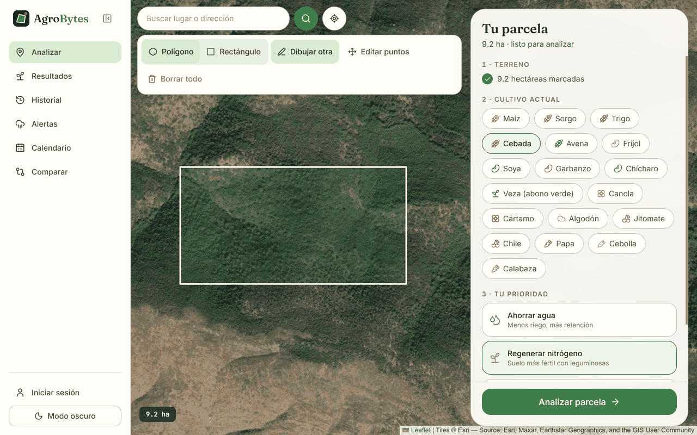
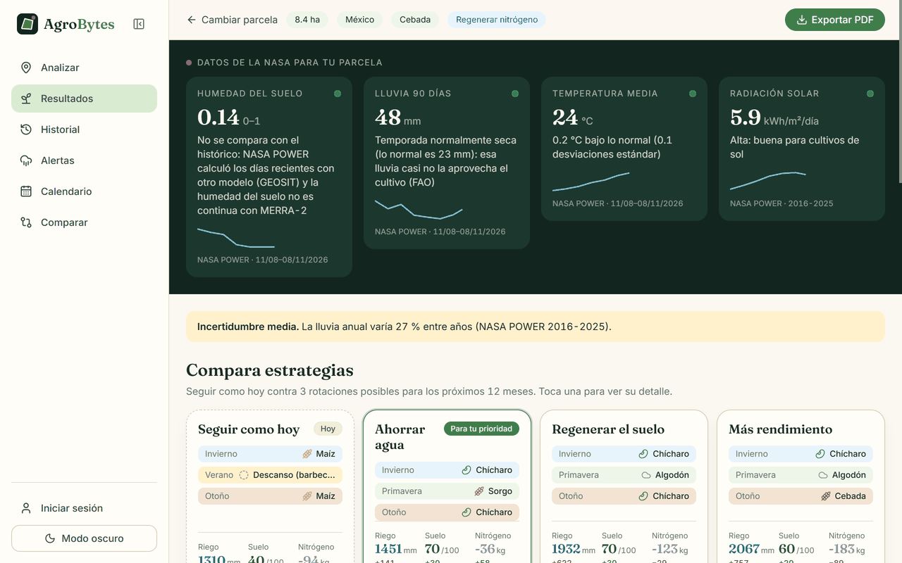
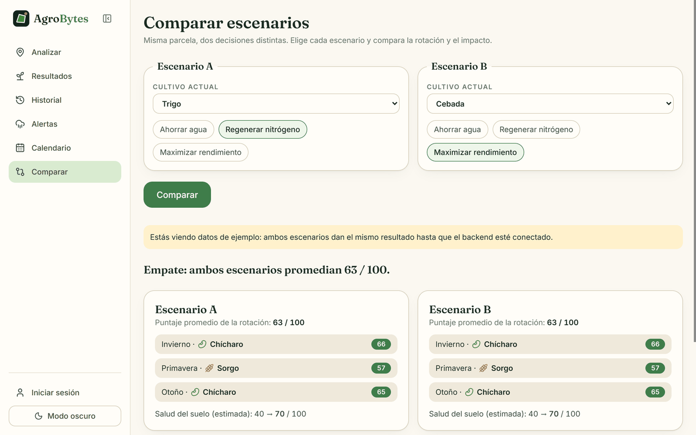
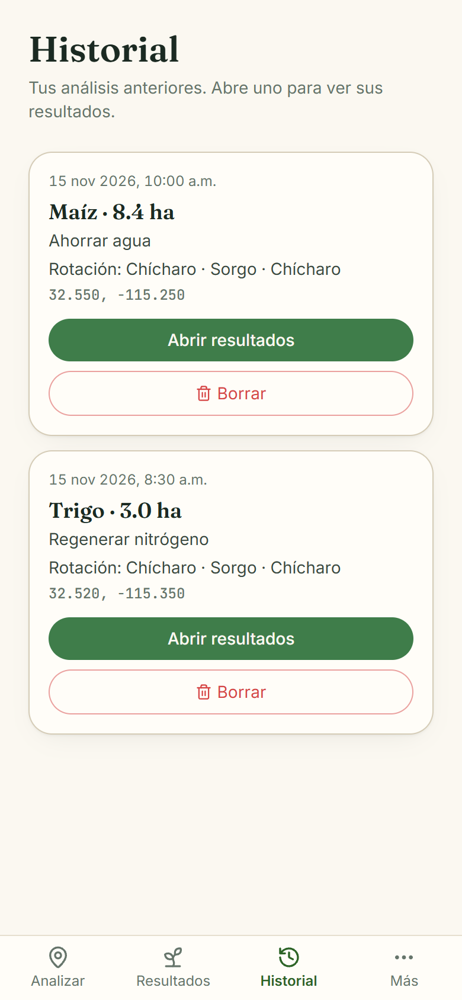
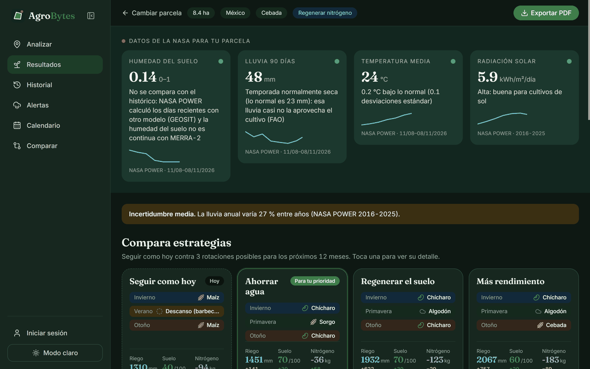

# 🌱 AgroBytes

**[English](README.md) · [Español](README.es.md)**

## Turning NASA Earth observation data into smart farming decisions

> **🔗 Live app (for judges): https://agrobytes-web.onrender.com/**
> Open the link, draw your field on the map, pick your current crop and priority, and press **Analyze field**.
> The app is in English by default; use the **EN / ES** button in the menu to switch to Spanish.
> *Hosted on Render's free plan: the first load may take up to a minute while the server wakes up.*



Farmers face increasingly unpredictable conditions due to climate change, water scarcity and soil degradation. NASA provides a huge amount of high-quality environmental data, but turning it into practical field decisions is still hard.

**AgroBytes** closes that gap: it turns climate and environmental data into clear, explainable crop-rotation recommendations that help growers save water, improve soil health and adapt to changing conditions.

---

## ▶️ Run it locally

You need [Docker](https://www.docker.com/).

```bash
git clone https://github.com/Maurongas/AgroBytes.git
cd AgroBytes
docker compose up --build
```

- App: http://localhost:3000
- API (interactive docs): http://localhost:8000/docs

---

## 🚜 The problem

Farmers must make critical decisions about what to plant, when, and how to preserve their resources, often with limited or hard-to-interpret information. Droughts, temperature swings, changing rainfall and soil decline raise agricultural risk, while valuable Earth observation data usually requires specialized knowledge to use.

## 💡 Our solution

From a field's location and the grower's goals, AgroBytes analyzes environmental conditions and proposes seasonal crop rotations aimed at:

- 💧 Saving water
- 🌱 Improving soil fertility
- ♻️ Restoring nutrients such as nitrogen
- 🌦️ Increasing resilience to adverse weather
- 📈 Keeping long-term productivity

| Results | Compare |
|---|---|
|  |  |

| History on mobile | Dark mode |
|---|---|
|  |  |

---

## 🛰️ NASA data integration

### NASA POWER
Location-based climate data: temperature, precipitation, solar radiation, soil moisture and weather trends.

### Other sources
- **ISRIC SoilGrids:** soil properties.
- **FAO ECOCROP:** crop requirements (temperature, rainfall, cycle).
- **FAOSTAT:** which crops are grown in each country.

### Future integrations
**SMAP** (soil moisture), **GPM IMERG** (precipitation), **ECOSTRESS** (crop water stress), **MODIS and Landsat** (vegetation), **SRTM** (slope and erosion risk).

---

## 🎯 How we address the challenge

- Uses NASA data to support farming decisions.
- Improves water-use efficiency.
- Promotes sustainable practices.
- Strengthens resilience to climate variability.
- Translates complex science into easy-to-apply recommendations.

## 🔍 Explainable recommendation engine

Every recommendation can be traced back to specific environmental conditions, crop characteristics and known agronomic principles. Instead of opaque answers, the system shows **why** a rotation is recommended, its risks, its estimated impact and its uncertainty. It is a transparent **rule-based engine** (not machine learning). See [docs/METODOLOGIA.md](docs/METODOLOGIA.md) and [docs/VALIDACION.md](docs/VALIDACION.md).

## ⚙️ Workflow

1. The farmer draws their field on the map.
2. The system queries NASA POWER climate data.
3. Climate and agronomic variables are analyzed.
4. The grower's goals are taken into account.
5. Explainable crop-rotation recommendations are generated.
6. The user gets clear information to support the decision.

## ⚠️ Limits

- Recommendations are **estimates based on agronomic rules**, not a prediction of the future.
- Alerts show the **typical risks of the year** from historical climate, not a weather forecast.
- Nitrogen and soil health are **rule-based estimates**.
- Each result states its **uncertainty**. It does not replace a visit from an agronomist.
- Coverage: Mexico, the United States and Canada.

## 🌍 Potential impact

✅ Better climate adaptation · ✅ Better water management · ✅ Soil health conservation · ✅ Lower agricultural risk · ✅ Simple access to NASA science data · ✅ More sustainable decisions

## 🚀 Vision

We want AgroBytes to become a comprehensive resilient-agriculture platform combining Earth observations, environmental analysis and accessible agronomic advice for any grower.

---

## 👥 Team

| Area | Role | Owner | Issue |
|---|---|---|---|
| Frontend | Layout and navigation | Fernando (FernandoBorbas) | #1 |
| Frontend | Map | Mía (hdmiaa) | #2 |
| Frontend | PWA and data | Ximena (menaxmn) | #3 |
| Backend | Database | Daniel (daniel379618) | #4 |
| Backend | API, NASA POWER and rules | Mauro (Maurongas) | #5 |

Built for the **NASA Space Apps Challenge 2026** — "Field Shift" challenge. Technical docs (in Spanish) are in [docs/](docs/).
