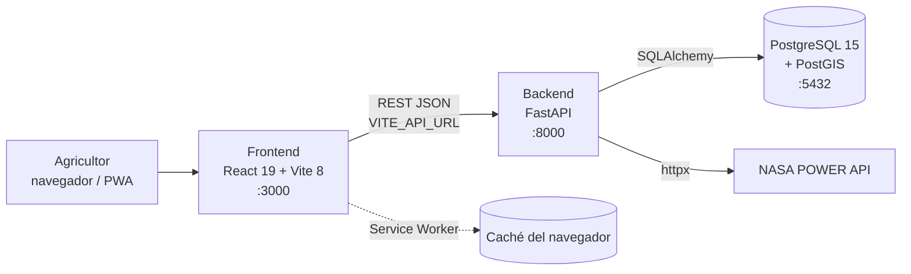
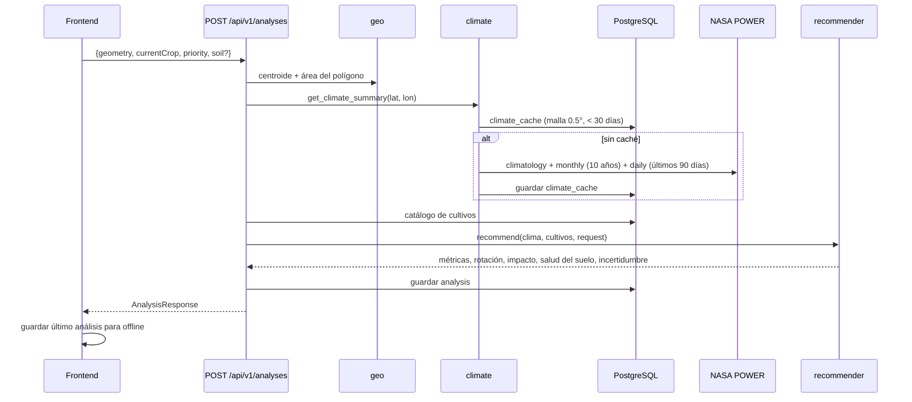
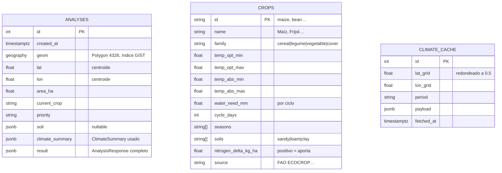

# Arquitectura — NasaSpaceApp (DSS Agrícola)

> **Fuente de verdad del proyecto.** Si cambias el contrato de la API (§5), el modelo de datos (§6)
> o la estructura de carpetas (§4), **actualiza este archivo en el mismo PR**.
> Qué cambió respecto a la versión 1.0 y cómo ponerte al día: [`CAMBIOS-ARQUITECTURA.md`](CAMBIOS-ARQUITECTURA.md).

Versión: **2.0 (definitiva)** · Fecha: 2026-11-14

---

## 1. Problema y propuesta

**Reto:** NASA Space Apps — "Cambio de campo".
**Producto:** Sistema de Apoyo a la Decisión (DSS) para agricultores. El agricultor **dibuja su parcela en
el mapa**, elige su cultivo actual y su prioridad. El sistema obtiene el clima de esa ubicación de
**NASA POWER** y un **motor de reglas agronómicas** recomienda una **rotación de cultivos por temporada**,
explicando razones, riesgos, impacto estimado e incertidumbre.

**Principios:**
1. El usuario **no captura** clima a mano: sale de NASA POWER a partir de la parcela.
2. **Honestidad de datos.** Solo se muestra como "dato NASA" lo que viene de NASA POWER. Lo calculado por
   reglas (nitrógeno, salud del suelo) se etiqueta como **estimado**. No se dice "ML", "IA" ni
   "satélite" de algo que no lo es (el mapa base sí es imagen satelital de Esri, solo como fondo).

### Alcance MVP
1. Dibujar la parcela en el mapa (polígono) y elegir cultivo actual + prioridad.
2. Ver métricas NASA POWER de la parcela (humedad del suelo en raíz, lluvia 90 días, temperatura, radiación solar) y su clima mensual.
3. Recibir una rotación de 3 temporadas con puntaje 0–100, razones y riesgos.
4. Ver el impacto estimado (agua, riego, nitrógeno, salud del suelo) y la incertidumbre.
5. Historial de análisis.
6. App instalable (PWA) que muestra la interfaz y el último análisis sin internet.

### Fuera del MVP (solo si sobra tiempo)
- NDVI real (MODIS/VIIRS/Sentinel-2), SMAP, GPM IMERG: requieren cuenta Earthdata y procesar rasters.
- Rendimiento estimado (t/ha): no hay fuente confiable sin un modelo de cultivo.
- Autenticación, parcelas guardadas con nombre.
- Fuentes solo de EE. UU. (SSURGO, CropScape, PRISM…): no cubren la zona de demo (Baja California).

---

## 2. Vista general



| Contenedor | Tecnología | Responsabilidad | Dueño |
|---|---|---|---|
| Frontend | React 19, Vite 8, TypeScript 6, Tailwind 4, react-leaflet 5, Zustand, TanStack Query, Recharts, Framer Motion | UI, mapa, PWA/offline | Fernando (layout), Mia/hdmiaa (mapa), menaxmn (PWA + datos) |
| Backend | Python 3.11, FastAPI, Pydantic v2, httpx | API, NASA POWER, motor de reglas | Mauro (Maurongas) |
| Base de datos | PostgreSQL 15 + PostGIS 3.3, SQLAlchemy 2, Alembic, GeoAlchemy2 | Persistencia, migraciones, catálogo de cultivos, caché de clima | Daniel (daniel379618) |
| Fuente externa | NASA POWER (sin API key) | Clima histórico y reciente por punto | — |

Todo corre con `docker compose up --build` (ver `docs/GUIA-INICIO.md`).

---

## 3. Flujo principal: analizar una parcela



Si NASA no responde y no hay caché → `503 {"detail": "NASA POWER no disponible"}`.

---

## 4. Estructura de carpetas (oficial)

```
NasaSpaceApp/
├── docker-compose.yml           # db + backend + frontend
├── .env.example                 # variables (copiar a .env, opcional)
├── CLAUDE.md                    # contexto general para agentes
├── docs/
│   ├── ARQUITECTURA.md          # este archivo
│   ├── CAMBIOS-ARQUITECTURA.md  # qué cambió en v2.0 y cómo actualizarse
│   ├── GUIA-INICIO.md, GUIA-GIT.md
│   └── contexto/                # contexto por rol para agentes
├── backend/
│   ├── Dockerfile, requirements.txt (versiones fijadas)
│   ├── alembic.ini, alembic/versions/       [DBA · pendiente]
│   ├── research/                # script de investigación de fuentes (no es parte de la app) [Backend]
│   ├── tests/                   # pytest                                     [Backend + DBA]
│   └── app/
│       ├── main.py              # app, CORS, routers, /health                [Backend]
│       ├── core/config.py       # Settings desde env (pydantic-settings)     [DBA]
│       ├── db/database.py       # engine, SessionLocal, Base, get_db         [DBA]
│       ├── db/seed.py           # carga data/crops.json                      [DBA · pendiente]
│       ├── models/              # analysis.py crop.py climate_cache.py       [DBA · pendiente]
│       ├── repositories/        # analyses.py crops.py climate_cache.py      [DBA · pendiente]
│       ├── data/crops.json      # catálogo semilla                           [DBA · pendiente]
│       ├── schemas/             # contrato API (Pydantic)                    [Backend]
│       │   ├── base.py  analysis.py  climate.py  crop.py
│       ├── api/v1/              # routers delgados                           [Backend]
│       │   ├── analyses.py  climate.py  crops.py
│       └── services/            # lógica                                     [Backend · pendiente]
│           ├── geo.py           # centroide y área del polígono (puro)
│           ├── nasa_power.py    # cliente HTTP NASA POWER
│           ├── climate.py       # resumen climático + caché
│           └── recommender.py   # motor de reglas (puro, sin I/O)
└── frontend/
    ├── Dockerfile, vite.config.ts, index.html, package.json
    ├── public/                  # favicon, íconos PWA                        [PWA]
    └── src/
        ├── main.tsx             # React + QueryClient (+ registro del SW)    [PWA]
        ├── App.tsx              # navegación entre vistas                    [Layout]
        ├── index.css            # tema (tokens de color, fuentes)            [Layout]
        ├── api/
        │   ├── types.ts         # espejo EXACTO de §5                        [PWA · revisa Backend]
        │   ├── client.ts        # cliente único (createAnalysis, listAnalyses, getAnalysis) [PWA]
        │   └── mock.ts          # datos de ejemplo con la forma de §5        [PWA]
        ├── store/useStore.ts    # estado global (Zustand)                    [Mapa; otros agregan campos avisando]
        ├── lib/
        │   ├── crops.ts         # catálogo de cultivos para la UI            [Mapa]
        │   └── offline.ts       # guardar/leer último análisis               [PWA · pendiente]
        ├── views/
        │   ├── SelectView.tsx   # mapa + panel                               [Mapa]
        │   ├── DiagnosisView.tsx# resultados                                 [Layout]
        │   └── HistoryView.tsx  # historial                                  [Layout · pendiente]
        └── components/
            ├── ParcelMap.tsx  QuickPanel.tsx  ScanOverlay.tsx                [Mapa]
            ├── NasaMetricCard.tsx  ImpactBar.tsx  GaugeSoilHealth.tsx  CountUp.tsx [Layout]
            └── Navbar.tsx                                                    [Layout · pendiente]
```

---

## 5. Contrato de la API (v1)

Base: `VITE_API_URL` (local `http://localhost:8000`). JSON en **camelCase** (en Python se escribe
snake_case; `schemas/base.py` hace la conversión). Documentación viva en `/docs`.
**Espejos que deben coincidir:** `backend/app/schemas/` ⇄ `frontend/src/api/types.ts` ⇄ esta sección.

| Método | Ruta | Descripción | Estado |
|---|---|---|---|
| GET | `/health` | Estado del backend y de la BD | ✅ listo |
| POST | `/api/v1/analyses` | Analiza una parcela: clima + rotación; guarda el análisis | 501 (stub) |
| GET | `/api/v1/analyses?limit=20` | Historial (resúmenes) | 501 (stub) |
| GET | `/api/v1/analyses/{id}` | Detalle de un análisis guardado | 501 (stub) |
| GET | `/api/v1/climate?lat=&lon=` | Resumen climático NASA POWER de un punto (útil para depurar) | 501 (stub) |
| GET | `/api/v1/crops` | Catálogo de cultivos | 501 (stub) |

Mientras un endpoint responda 501, el frontend trabaja con `VITE_USE_MOCK=true` (valor por defecto).

### 5.1 Enums (códigos en inglés; las etiquetas en español viven en el frontend)
| Campo | Valores |
|---|---|
| `priority` | `water` (ahorrar agua) · `nitrogen` (regenerar nitrógeno) · `yield` (maximizar rendimiento) |
| `season` | `autumn` · `winter` · `spring` · `summer` |
| `soil.texture` | `sandy` · `loam` · `clay` |
| `status` (métrica) | `ok` · `warn` · `danger` |
| `uncertainty.level` | `low` · `medium` · `high` |
| `metrics[].id` | `soilMoisture` · `rain90d` · `tempMean` · `solarRadiation` |
| cultivos (`currentCrop`, `cropId`) | `maize` · `wheat` · `soy` · `bean` · `chile` · `tomato` · `oat` · `sorghum` (= `frontend/src/lib/crops.ts` = `crops.json`) |

### 5.2 `POST /api/v1/analyses`
Request:
```json
{
  "geometry": { "type": "Polygon", "coordinates": [[[-116.61, 31.85], [-116.59, 31.85], [-116.59, 31.87], [-116.61, 31.85]]] },
  "currentCrop": "maize",
  "priority": "water",
  "soil": { "texture": "clay" }
}
```
- `geometry`: GeoJSON Polygon, coordenadas `[lon, lat]`, anillo cerrado (≥ 4 puntos). Si no → `422`.
- `soil` es opcional (hoy la UI no lo pide; si falta, el factor suelo vale 1).

Response `201`:
```json
{
  "id": "42",
  "createdAt": "2026-11-14T18:22:10Z",
  "areaHa": 8.4,
  "location": { "lat": 31.86, "lon": -116.6 },
  "metrics": [
    { "id": "soilMoisture", "label": "Humedad del suelo", "value": 0.21, "unit": "0–1", "status": "warn",
      "meaning": "Algo seco para maíz", "series": [0.31, 0.3, "… 12 valores mensuales"], "source": "NASA POWER · 2015-2024" }
  ],
  "rotation": [
    { "season": "winter", "cropId": "oat", "score": 84,
      "reasons": ["Cubre el suelo y reduce la erosión", "Tolera temperaturas bajas"],
      "waterSavingPct": 38, "nitrogenDelta": -8, "risks": ["Rendimiento menor si falta lluvia en enero"],
      "plantingWindow": "Dic – Ene" }
  ],
  "impact": [
    { "label": "Balance hídrico", "unit": "mm", "current": -120, "recommended": -45, "betterWhen": "higher" },
    { "label": "Riego necesario", "unit": "mm", "current": 520, "recommended": 340, "betterWhen": "lower" },
    { "label": "Nitrógeno en suelo (estimado)", "unit": "kg/ha", "current": 38, "recommended": 71, "betterWhen": "higher" }
  ],
  "soilHealth": { "current": 52, "recommended": 74 },
  "climate": [{ "month": "Ene", "rain": 62, "temp": 14 }, "… 12 meses"],
  "uncertainty": { "level": "high", "reason": "La lluvia anual varía 38 % entre años" }
}
```
- `metrics`: siempre las 4 de §5.1, en ese orden. Todas de NASA POWER.
- `rotation`: siempre 3 pasos, en orden cronológico (ver §7).
- `impact`: siempre esos 3 renglones, en ese orden.
- `soilHealth` y `nitrogenDelta` son **estimaciones por reglas**; la UI lo indica.

### 5.3 `GET /api/v1/analyses?limit=20`
```json
[
  { "id": "42", "createdAt": "2026-11-14T18:22:10Z", "location": { "lat": 31.86, "lon": -116.6 },
    "areaHa": 8.4, "currentCrop": "maize", "priority": "water", "rotationCrops": ["oat", "bean", "sorghum"] }
]
```
Ordenado del más reciente al más antiguo. `limit` ∈ [1, 100].

### 5.4 `GET /api/v1/analyses/{id}`
El mismo `AnalysisResponse` de §5.2 (se lee del JSON guardado). `404` si no existe.

### 5.5 `GET /api/v1/climate?lat=31.86&lon=-116.6`
```json
{
  "lat": 31.86, "lon": -116.6, "source": "NASA POWER (community=AG)", "period": "2015-2024",
  "tempMeanC": 17.4, "rainAnnualMm": 262.0, "rainCvPct": 38.5, "soilMoistureRoot": 0.31,
  "monthly": [
    { "month": 1, "tempC": 13.2, "tempMaxC": 19.0, "tempMinC": 7.4, "rainMm": 48.1, "soilMoistureRoot": 0.38, "solarRadiation": 3.2 }
  ]
}
```
`monthly` tiene 12 elementos. `lat` ∈ [-90, 90], `lon` ∈ [-180, 180] → si no, `422`.

### 5.6 `GET /api/v1/crops`
```json
[{ "id": "bean", "name": "Frijol", "family": "legume", "seasons": ["spring", "summer"], "soils": ["loam", "clay"],
   "waterNeedMm": 350, "nitrogenDeltaKgHa": 40 }]
```

### 5.7 Errores
| Código | Cuándo |
|---|---|
| 422 | Validación (Pydantic): polígono inválido, enums, rangos |
| 404 | `analyses/{id}` no existe |
| 501 | Endpoint aún no implementado (temporal) |
| 503 | NASA POWER caído y sin caché |

Formato siempre: `{"detail": "mensaje legible en español"}` (el `client.ts` lo muestra tal cual).

---

## 6. Modelo de datos



Reglas:
- **Migraciones con Alembic** (no `create_all`). La primera migración crea las 3 tablas,
  `CREATE EXTENSION IF NOT EXISTS postgis` y **elimina la tabla vieja `historial_consultas`**.
- `climate_cache`: único en `(lat_grid, lon_grid, period)`. La malla de NASA POWER es de ~0.5°.
- `crops` se llena con `app/db/seed.py` desde `app/data/crops.json` (idempotente: upsert por `id`).
  Los `id` deben ser exactamente los de §5.1. Fuente de rangos: FAO ECOCROP / GAEZ.
- No hay tabla `farms` en el MVP (las parcelas viven dentro de cada análisis).

---

## 7. Motor de reglas (`services/recommender.py`)

Función **pura** (sin BD ni HTTP): `recommend(clima, cultivos, req, hoy) -> resultado`. Reglas
transparentes; cada número de la respuesta debe poder explicarse con esta sección.

**Temporadas por hemisferio** (si `lat < 0` se invierten):
| Temporada | Meses (norte) |
|---|---|
| spring | Mar, Abr, May |
| summer | Jun, Jul, Ago |
| autumn | Sep, Oct, Nov |
| winter | Dic, Ene, Feb |

Clima de cada temporada = promedio de `tempC` y suma de `rainMm` de sus 3 meses (de `monthly`).

**Rotación:** 3 pasos = las **3 temporadas siguientes** a la fecha del análisis. Para cada paso se
evalúan los cultivos cuyo `seasons` incluye esa temporada:

| Factor | Cálculo (0–1) | Peso |
|---|---|---|
| temperatura | 1 si temp ∈ [opt_min, opt_max]; baja lineal a 0 en los límites absolutos | 0.40 |
| agua | `min(1, lluvia_temporada / water_need_mm)` | 0.30 |
| suelo | 1 si `soil.texture` ∈ `soils` o no hay `soil`; si no, 0.5 | 0.15 |
| prioridad | `water` → `1 − water_need/máx_del_catálogo`; `nitrogen` → legume 1, cover 0.7, otro 0; `yield` → cereal/vegetable 1, otro 0.5 | 0.15 |

- `score = round(100 × Σ peso·factor)`. Si temperatura = 0 → el cultivo se descarta en esa temporada.
- **Regla de rotación:** misma familia que el paso anterior (o que `currentCrop` en el paso 1) → score × 0.7.
  Nunca el mismo cultivo dos pasos seguidos.
- Se elige el de mayor score por paso.
- `reasons`: frases generadas desde los factores más altos y la regla de rotación.
- `risks`: temperatura de la temporada a < 3 °C de `temp_abs_min` → "Riesgo de helada"; factor agua < 0.6 →
  "Requiere riego"; incertidumbre alta → "Lluvia muy variable entre años".
- `waterSavingPct = round(100 × (need(currentCrop) − need(cultivo)) / need(currentCrop))`.
- `nitrogenDelta` = `nitrogen_delta_kg_ha` del catálogo.
- `plantingWindow` = primeros 2 meses de la temporada (ej. "Sep – Oct").

**Impacto** (`current` = repetir `currentCrop` en las 3 temporadas; `recommended` = la rotación):
- Balance hídrico = Σ(lluvia_temporada − water_need).
- Riego necesario = Σ max(0, water_need − lluvia_temporada).
- Nitrógeno en suelo (estimado) = 40 + Σ nitrogenDelta.

**Salud del suelo (índice estimado 0–100):** 50 + 10 por leguminosa + 8 por cobertura − 10 por cada par de
pasos consecutivos de la misma familia; acotado a [0, 100]. Se calcula igual para `current` y `recommended`.

**Métricas** (`series` = 12 valores mensuales de la climatología):
| id | Valor | `status` sugerido |
|---|---|---|
| soilMoisture | `GWETROOT` medio (0–1) | < 0.3 danger · < 0.5 warn · si no ok |
| rain90d | Σ `PRECTOTCORR` de los últimos 90 días (endpoint daily) vs. climatología del mismo periodo | < −30 % danger · < −10 % warn |
| tempMean | `T2M` medio de los últimos 30 días vs. climatología del mes | > +2 °C danger · > +1 °C warn |
| solarRadiation | `ALLSKY_SFC_SW_DWN` medio | informativo (ok) |

**Incertidumbre:** `rainCvPct` (coef. de variación de la lluvia anual 2015–2024) < 15 → low · 15–30 → medium ·
> 30 → high. Sube un nivel si `soilMoistureRoot` < 0.3. `reason` explica el porqué en una frase.

**Área y centroide** (`services/geo.py`, puro): centroide = promedio de vértices; área con proyección
equirectangular local (error < 1 % para parcelas). Sin dependencias extra.

---

## 8. Integración NASA POWER (`services/nasa_power.py`)

Sin API key. Docs: https://power.larc.nasa.gov/docs/services/api/ (resumen en `backend/research/`).

| Uso | Endpoint |
|---|---|
| Promedios mensuales de largo plazo (series, `climate`) | `GET /api/temporal/climatology/point` |
| Serie mensual 2015–2024 (variabilidad → incertidumbre) | `GET /api/temporal/monthly/point?start=2015&end=2024` |
| Últimos 90 días (rain90d, tempMean) | `GET /api/temporal/daily/point?start=YYYYMMDD&end=YYYYMMDD` |

Parámetros: `parameters=T2M,T2M_MAX,T2M_MIN,PRECTOTCORR,GWETROOT,ALLSKY_SFC_SW_DWN&community=AG&latitude=..&longitude=..&format=JSON`

- Valores en `properties.parameter.<PARAM>`; unidades en `parameters.<PARAM>.units`. **Verifica unidades**:
  la precipitación viene en mm/día → multiplicar por los días del mes; la radiación cambia de unidad según `community`.
- `-999` = sin dato → ignorar. En el endpoint mensual el "mes 13" (ej. `201513`) es el promedio anual.
- Los datos diarios recientes tienen unos días de retraso: pide hasta "hoy − 7 días".
- Timeout 20 s, 2 reintentos, excepción propia `NasaUnavailableError`. Siempre pasar por `climate_cache`.

---

## 9. Frontend

- **Una sola app React + Vite** (`frontend/`). No hay SSR ni Next.js.
- **Vistas** controladas por `view` en `useStore` (`'select' | 'diagnosis' | 'history'`); no se usa router.
- **Mapa:** react-leaflet; el usuario dibuja el polígono (clics + "terminar"); `@turf/turf` calcula el área
  para mostrarla. GeoJSON usa `[lon, lat]`, Leaflet `[lat, lon]`: la conversión vive solo en `useStore`.
- **Cliente API único** (`src/api/client.ts`): nadie hace `fetch` en componentes. Peticiones con TanStack Query.
  `VITE_USE_MOCK=true` → responde con `mock.ts` (misma forma que §5).
- **Tipos** (`src/api/types.ts`): espejo exacto de §5. TS sin `any` en datos de la API.
- **PWA:** `vite-plugin-pwa` (manifest + service worker generado). Estrategia: precache del app shell;
  NetworkFirst para `/api/*`; el último análisis se guarda en `localStorage` (`lib/offline.ts`). No cachear
  masivamente los tiles del mapa (términos de uso del proveedor).
- **Tema:** tokens en `src/index.css` (`@theme`: canvas, ink, leaf, clay, sky, sun, moist, nitro, ok/warn/danger).
  No escribir colores sueltos; usar los tokens.
- Idioma: español (`<html lang="es">`), etiquetas de enums en español en el frontend.

---

## 10. Configuración y entornos

`docker-compose.yml` ya trae valores por defecto; `.env` (copia de `.env.example`) solo si quieres cambiarlos.
```
POSTGRES_USER=admin  POSTGRES_PASSWORD=password  POSTGRES_DB=agridb
DATABASE_URL=postgresql+psycopg://admin:password@db:5432/agridb
CORS_ORIGINS=http://localhost:3000
NASA_POWER_BASE_URL=https://power.larc.nasa.gov/api
CLIMATE_CACHE_DAYS=30
VITE_API_URL=http://localhost:8000
VITE_USE_MOCK=true
```
| Servicio | URL |
|---|---|
| Frontend | http://localhost:3000 |
| API + docs | http://localhost:8000/docs |
| BD | localhost:5432 |

---

## 11. Convenciones de trabajo

- **Ramas:** `feature/<area>-<tema>` → PR a `main` con la plantilla. Mínimo 1 revisión.
- **Cambios de contrato** (§5 o §6): el PR toca este documento **y** `frontend/src/api/types.ts` + `mock.ts`
  **y** `backend/app/schemas/`. Avisar al equipo.
- **Commits:** `feat:`, `fix:`, `chore:`, `docs:`, `refactor:`.
- **Python:** type hints, Pydantic v2, `datetime.now(timezone.utc)`, routers delgados (lógica en `services/`,
  SQL en `repositories/`). Dependencias con versión fijada.
- **TS:** sin `any` en datos de la API; colores con tokens del tema.
- **No subir:** `.env`, `node_modules`, `dist`, `__pycache__`.

---

## 12. Plan por fases

| Fase | Objetivo | Entregables |
|---|---|---|
| 0 — Base ✅ | Una sola arquitectura | Esta v2.0: frontend único, backend con estructura, contrato, stubs, docs |
| 1 — Datos reales | NASA → backend | `nasa_power.py`, `climate.py`, `/climate`; Alembic + modelos + `crops.json` |
| 2 — Recomendación | Lógica real | `geo.py`, `recommender.py`, `POST /analyses`; frontend con `VITE_USE_MOCK=false` |
| 3 — Persistencia y UX | Historial, PWA | `GET /analyses`, `HistoryView`, Navbar, PWA + offline, mostrar incertidumbre |
| 4 — Pulido | Demo | Textos, 2–3 ubicaciones de demo ya en caché, video/pitch |

## 13. Mapeo issues ↔ arquitectura

| Issue | Responsable | Corresponde a |
|---|---|---|
| #1 Layout y Navegación | FernandoBorbas | §9: `App.tsx`, `index.css`, `DiagnosisView`, `HistoryView`, `Navbar`, tarjetas |
| #2 Mapa Interactivo | hdmiaa (Mia) | §9: `ParcelMap`, `QuickPanel`, `SelectView`, `useStore`, `lib/crops.ts` |
| #3 PWA (Offline) | menaxmn | §9: `vite-plugin-pwa`, `api/`, `lib/offline.ts`, `main.tsx`, íconos |
| #4 Modelos de BD | daniel379618 | §6 completo: `core/`, `db/`, `models/`, `repositories/`, Alembic, seed |
| #5 Conexión API NASA | Maurongas | §3, §5, §7, §8: `services/`, `schemas/`, `api/v1/` |
