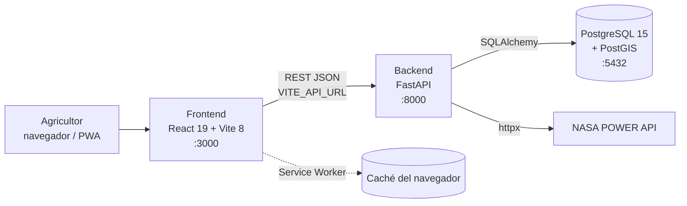
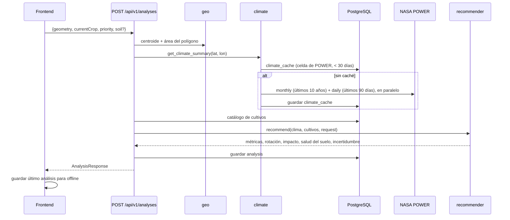
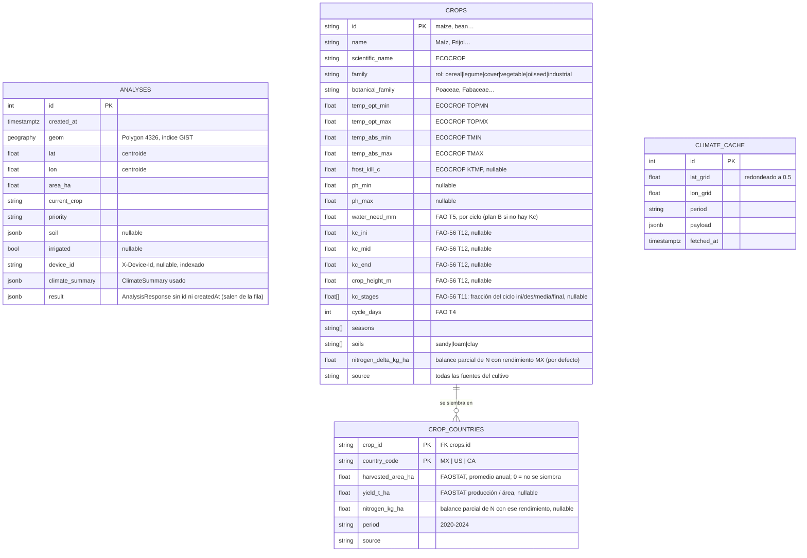

# Arquitectura — NasaSpaceApp (DSS Agrícola)

> **Fuente de verdad del proyecto.** Si cambias el contrato de la API (§5), el modelo de datos (§6)
> o la estructura de carpetas (§4), **actualiza este archivo en el mismo PR**.
> Qué cambió respecto a la versión 1.0 y cómo ponerte al día: [`CAMBIOS-ARQUITECTURA.md`](CAMBIOS-ARQUITECTURA.md).

Versión: **2.3** · Fecha: 2026-11-15 (2.3: motor con fuentes publicadas — EcoCrop por ciclo, Penman-Monteith, curva Kc FAO-56, N de Ludemann/Herridge, rotación como línea de tiempo; campos opcionales en `/climate` y columnas nuevas en `crops`/`crop_countries`, ver [`METODOLOGIA.md`](METODOLOGIA.md) y [`VALIDACION.md`](VALIDACION.md); 2.2: `strategies`, `localChecks`, `climateShift`; 2.1: `guardar`, historial por dispositivo, `DELETE`, límite 429 — ver [`CAMBIOS-ARQUITECTURA.md`](CAMBIOS-ARQUITECTURA.md) §v2.1)

---

## 1. Problema y propuesta

**Reto:** NASA Space Apps — "Cambio de campo".
**Producto:** Sistema de Apoyo a la Decisión (DSS) para agricultores. El agricultor **dibuja su parcela en
el mapa**, elige su cultivo actual y su prioridad. El sistema obtiene el clima de esa ubicación de
**NASA POWER** y un **motor de reglas agronómicas** recomienda una **rotación de cultivos por temporada**,
explicando razones, riesgos, impacto estimado e incertidumbre.

**Principios:**
1. El usuario **no captura** clima a mano: sale de NASA POWER a partir de la parcela.
2. **Honestidad de datos.** Solo se muestra como "dato NASA" lo que viene de NASA POWER. Lo calculado por
   reglas (nitrógeno, salud del suelo) se etiqueta como **estimado**. No se dice "ML", "IA" ni
   "satélite" de algo que no lo es (el mapa base sí es imagen satelital de Esri, solo como fondo).

### Alcance MVP
1. Dibujar la parcela en el mapa (polígono) y elegir cultivo actual + prioridad.
2. Ver métricas NASA POWER de la parcela (humedad del suelo en raíz, lluvia 90 días, temperatura, radiación solar) y su clima mensual.
3. Recibir una rotación de 3 temporadas con puntaje 0–100, razones y riesgos.
4. Ver el impacto estimado (agua, riego, nitrógeno, salud del suelo) y la incertidumbre.
5. Historial de análisis.
6. App instalable (PWA) que muestra la interfaz y el último análisis sin internet.

### Fuera del MVP (solo si sobra tiempo)
- NDVI real (MODIS/VIIRS/Sentinel-2), SMAP, GPM IMERG: requieren cuenta Earthdata y procesar rasters.
- Rendimiento estimado (t/ha): no hay fuente confiable sin un modelo de cultivo.
- Autenticación real y parcelas guardadas con nombre. (El frontend incluye un perfil local sin servidor: nombre, correo y granja guardados en el navegador.)
- Fuentes solo de EE. UU. (SSURGO, CropScape, PRISM…): no cubren la zona de demo (Baja California).

---

## 2. Vista general



| Contenedor | Tecnología | Responsabilidad | Dueño |
|---|---|---|---|
| Frontend | React 19, Vite 8, TypeScript 6, Tailwind 4, react-leaflet 5, Zustand, TanStack Query, Recharts, Framer Motion | UI, mapa, PWA/offline | Fernando (layout), Mia/hdmiaa (mapa), menaxmn (PWA + datos) |
| Backend | Python 3.11, FastAPI, Pydantic v2, httpx | API, NASA POWER, motor de reglas | Mauro (Maurongas) |
| Base de datos | PostgreSQL 15 + PostGIS 3.3, SQLAlchemy 2, Alembic, GeoAlchemy2 | Persistencia, migraciones, catálogo de cultivos, caché de clima | Daniel (daniel379618) |
| Fuente externa | NASA POWER (sin API key) | Clima histórico y reciente por punto | — |

Todo corre con `docker compose up --build` (ver `docs/GUIA-INICIO.md`).

---

## 3. Flujo principal: analizar una parcela



Si NASA no responde y no hay caché → `503 {"detail": "NASA POWER no disponible"}`.

Caché de clima en dos niveles: memoria (rápido) → tabla `climate_cache` (sobrevive reinicios). Si NASA está
caído se usa el registro guardado **aunque esté vencido**; si la BD falla, se sigue sin caché (nunca tumba el análisis).
El catálogo se lee de la tabla `crops`. El análisis se guarda en `analyses` y el `id` de la respuesta es el de la BD.

---

## 4. Estructura de carpetas (oficial)

```
NasaSpaceApp/
├── docker-compose.yml           # db + backend + frontend
├── .env.example                 # variables (copiar a .env, opcional)
├── AGENTS.md                    # contexto general para asistentes de código
├── docs/
│   ├── ARQUITECTURA.md          # este archivo
│   ├── CAMBIOS-ARQUITECTURA.md  # qué cambió en v2.0 y cómo actualizarse
│   ├── GUIA-INICIO.md, GUIA-GIT.md
│   └── contexto/                # contexto por rol para agentes
├── backend/
│   ├── Dockerfile, requirements.txt (versiones fijadas)
│   ├── alembic.ini, alembic/versions/       [DBA ✅]
│   ├── research/                # script de investigación de fuentes (no es parte de la app) [Backend]
│   ├── tests/                   # pytest                                     [Backend + DBA]
│   └── app/
│       ├── main.py              # app, CORS, routers, /health                [Backend]
│       ├── core/config.py       # Settings desde env (pydantic-settings)     [DBA]
│       ├── db/database.py       # engine, SessionLocal, Base, get_db         [DBA]
│       ├── db/seed.py           # carga data/crops.json                      [DBA ✅]
│       ├── models/              # analysis.py crop.py climate_cache.py       [DBA ✅]
│       ├── repositories/        # analyses.py crops.py climate_cache.py      [DBA ✅]
│       ├── data/crops.json      # catálogo semilla                           [DBA ✅]
│       ├── schemas/             # contrato API (Pydantic)                    [Backend]
│       │   ├── base.py  analysis.py  climate.py  crop.py
│       ├── api/v1/              # routers delgados                           [Backend]
│       │   ├── analyses.py  climate.py  crops.py
│       └── services/            # lógica                                     [Backend ✅]
│           ├── geo.py           # centroide y área del polígono (puro)
│           ├── nasa_power.py    # cliente HTTP NASA POWER
│           ├── climate.py       # resumen climático + caché
│           └── recommender.py   # motor de reglas (puro, sin I/O)
└── frontend/
    ├── Dockerfile, vite.config.ts, index.html, package.json
    ├── public/                  # favicon, íconos PWA                        [PWA]
    └── src/
        ├── main.tsx             # React + QueryClient (+ registro del SW)    [PWA]
        ├── App.tsx              # navegación entre vistas                    [Layout]
        ├── index.css            # tema (tokens de color, fuentes)            [Layout]
        ├── api/
        │   ├── types.ts         # espejo EXACTO de §5                        [PWA · revisa Backend]
        │   ├── client.ts        # cliente único (createAnalysis, listAnalyses, getAnalysis) [PWA]
        │   └── mock.ts          # datos de ejemplo con la forma de §5        [PWA]
        ├── store/useStore.ts    # estado global (Zustand)                    [Mapa; otros agregan campos avisando]
        ├── lib/
        │   ├── crops.ts         # catálogo de cultivos para la UI            [Mapa]
        │   └── offline.ts       # guardar/leer último análisis               [PWA]
        ├── views/
        │   ├── SelectView.tsx   # mapa + panel                               [Mapa]
        │   ├── DiagnosisView.tsx# resultados                                 [Layout]
        │   └── HistoryView.tsx  # historial                                  [Layout]
        └── components/
            ├── ParcelMap.tsx  QuickPanel.tsx  ScanOverlay.tsx                [Mapa]
            ├── NasaMetricCard.tsx  ImpactBar.tsx  GaugeSoilHealth.tsx  CountUp.tsx [Layout]
            └── Navbar.tsx                                                    [Layout]
```

---

## 5. Contrato de la API (v1)

Base: `VITE_API_URL` (local `http://localhost:8000`). JSON en **camelCase** (en Python se escribe
snake_case; `schemas/base.py` hace la conversión). Documentación viva en `/docs`.
**Espejos que deben coincidir:** `backend/app/schemas/` ⇄ `frontend/src/api/types.ts` ⇄ esta sección.

| Método | Ruta | Descripción | Estado |
|---|---|---|---|
| GET | `/health` | Estado del backend y de la BD | ✅ listo |
| POST | `/api/v1/analyses?guardar=true` | Analiza una parcela: clima + rotación; guarda el análisis (`guardar=false` → no lo guarda) | ✅ listo |
| GET | `/api/v1/analyses?limit=20` | Historial (resúmenes) | ✅ listo |
| GET | `/api/v1/analyses/{id}` | Detalle de un análisis guardado | ✅ listo |
| DELETE | `/api/v1/analyses/{id}` | Borra un análisis del historial (solo el dispositivo que lo creó) | ✅ listo |
| GET | `/api/v1/climate?lat=&lon=` | Resumen climático NASA POWER de un punto (útil para depurar) | ✅ listo |
| GET | `/api/v1/crops` | Catálogo de cultivos (FAO ECOCROP + FAO) | ✅ listo |
| GET | `/api/v1/soil?lat=&lon=` | Suelo estimado del punto (ISRIC SoilGrids); 404 si no hay dato | ✅ listo |

Todos los endpoints están implementados: el frontend ya puede usar `VITE_USE_MOCK=false`.

**Header `X-Device-Id` (opcional, recomendado):** identificador anónimo del dispositivo — un UUID que el frontend
genera una vez y guarda en `localStorage`. 8–64 caracteres `[A-Za-z0-9_-]` (si no → `422`). **No es
autenticación**: solo separa el historial de cada dispositivo.

| Endpoint | Con `X-Device-Id` | Sin header |
|---|---|---|
| `POST /analyses` | el análisis queda a nombre del dispositivo | queda sin dueño |
| `GET /analyses` | solo los de ese dispositivo | todos (comportamiento anterior) |
| `GET /analyses/{id}` | `404` si es de otro dispositivo | se ve |
| `DELETE /analyses/{id}` | solo si es suyo; si no `404` | solo análisis sin dueño |

Con `REQUIRE_DEVICE_ID=true` (§10), `GET`/`DELETE` sin header → `400`. Se activa cuando el frontend ya lo mande.

### 5.1 Enums (códigos en inglés; las etiquetas en español viven en el frontend)
| Campo | Valores |
|---|---|
| `priority` | `water` (ahorrar agua) · `nitrogen` (regenerar nitrógeno) · `yield` (maximizar rendimiento) |
| `season` | `autumn` · `winter` · `spring` · `summer` |
| `soil.texture` | `sandy` · `loam` · `clay` |
| `status` (métrica) | `ok` · `warn` · `danger` |
| `uncertainty.level` | `low` · `medium` · `high` |
| `metrics[].id` | `soilMoisture` · `rain90d` · `tempMean` · `solarRadiation` |
| cultivos (`currentCrop`, `cropId`) | 18 ids de `backend/app/data/crops.json` (= `frontend/src/lib/crops.ts`): `maize` · `sorghum` · `wheat` · `barley` · `oat` · `bean` · `soy` · `chickpea` · `pea` · `vetch` · `canola` · `safflower` · `cotton` · `tomato` · `chile` · `potato` · `onion` · `squash` |
| `cropId` especial | `fallow` = descanso/barbecho (ningún cultivo tolera el clima de esa temporada); nunca es `currentCrop` |
| `family` (cultivo) | rol: `cereal` · `legume` · `cover` · `vegetable` · `oilseed` · `industrial` (la familia botánica va en `botanicalFamily`) |

### 5.2 `POST /api/v1/analyses`
Query opcional `guardar` (booleano, default `true`):

| `guardar` | Qué hace | Código | `id` |
|---|---|---|---|
| `true` u omitido | Analiza **y guarda** en `analyses` (aparece en el historial §5.3) | `201` | id de la BD: `"42"` |
| `false` | Analiza y devuelve el mismo `AnalysisResponse`, **sin guardarlo** | `200` | temporal: `"preview-3f9a1c2b7d4e"` |

- Uso: «Comparar escenarios» (`CompareView`) hace un análisis por escenario con `guardar=false`
  para no meter 2 filas al historial por cada comparación.
- El `id` `preview-…` no existe en la BD: `GET /analyses/{id}` → `404`. El frontend no debe guardarlo en el
  historial offline ni usarlo para "Abrir". `createdAt` es la hora del cálculo.
- El resultado es idéntico al de `guardar=true` con el mismo body (mismo motor, mismo clima en caché).
- Otro valor (`guardar=quizas`) → `422`. FastAPI acepta `false`/`0`/`no`/`off` y `true`/`1`/`yes`/`on`.
- Límite: `RATE_LIMIT_ANALYSES_PER_MIN` (default 30) análisis por IP por minuto, cuenten o no para el historial.
  Si se pasa → `429` con header `Retry-After` (segundos) y `detail` en español. Una comparación usa 2.

Request:
```json
{
  "geometry": { "type": "Polygon", "coordinates": [[[-116.61, 31.85], [-116.59, 31.85], [-116.59, 31.87], [-116.61, 31.85]]] },
  "currentCrop": "maize",
  "priority": "water",
  "soil": { "texture": "clay", "ph": 7.8, "organicMatter": "low" },
  "irrigated": true,
  "climateShift": { "rainPct": -20, "tempC": 1.5 }
}
```
- `geometry`: GeoJSON Polygon, coordenadas `[lon, lat]`, anillo cerrado (≥ 4 puntos). Si no → `422`.
  Además, **todos los vértices deben estar dentro de México, EE. UU. o Canadá** y el área debe estar entre
  **0.1 y 500 ha**; si no → `422` con un `detail` en español para mostrar al usuario (ver §7, *Región y tamaño*).
- `soil` es opcional. Lo que falte (textura o pH) se completa con **SoilGrids** (`soilDetected` en la respuesta).
  `soil.organicMatter` (`low`·`mid`·`high`, opcional) ajusta el índice `soilHealth` (§7); SoilGrids no lo da.
- `irrigated` es opcional: `true` = parcela de riego (el agua se compara por riego necesario); `false`/omitido = temporal.
- `climateShift` es opcional (v2.2): escenario hipotético «¿y si…?». `rainPct` ∈ [−60, 60] cambia la lluvia de cada
  mes en ese %, `tempC` ∈ [−3, 5] suma °C a cada mes. **Solo con `guardar=false`**; con `guardar=true` → `422`
  (un escenario inventado no debe quedar en el historial como si fuera un análisis real).

Response `201`:
```json
{
  "id": "42",
  "createdAt": "2026-11-14T18:22:10Z",
  "areaHa": 8.4,
  "location": { "lat": 31.86, "lon": -116.6 },
  "country": "MX",
  "metrics": [
    { "id": "soilMoisture", "label": "Humedad del suelo", "value": 0.21, "unit": "0–1", "status": "warn",
      "meaning": "Algo seco para maíz", "series": [0.31, 0.3, "… 12 valores mensuales"], "source": "NASA POWER · 2015-2024" }
  ],
  "rotation": [
    { "season": "winter", "cropId": "oat", "score": 84,
      "reasons": ["Cubre el suelo y reduce la erosión", "Tolera temperaturas bajas"],
      "waterSavingPct": 38, "nitrogenDelta": -8, "risks": ["Rendimiento menor si falta lluvia en enero"],
      "plantingWindow": "Dic – Ene", "irrigationMm": 120 },
    { "season": "spring", "cropId": "fallow", "score": 0, "reasons": ["Ningún cultivo del catálogo tolera…"],
      "waterSavingPct": 100, "nitrogenDelta": 0, "risks": [], "plantingWindow": "—", "irrigationMm": 0 }
  ],
  "impact": [
    { "label": "Agua total del cultivo", "unit": "mm", "current": 640, "recommended": 470, "betterWhen": "lower" },
    { "label": "Riego necesario", "unit": "mm", "current": 520, "recommended": 340, "betterWhen": "lower" },
    { "label": "Balance de nitrógeno (estimado)", "unit": "kg/ha", "current": 38, "recommended": 71, "betterWhen": "higher" }
  ],
  "soilHealth": { "current": 52, "recommended": 74 },
  "climate": [{ "month": "Ene", "rain": 62, "temp": 14 }, "… 12 meses"],
  "uncertainty": { "level": "high", "reason": "La lluvia anual varía 38 % entre años" },
  "soilDetected": { "texture": "clay", "ph": 7.8, "clayPct": 39.8, "sandPct": 29.2, "source": "ISRIC SoilGrids v2.0 (0–30 cm)" },
  "irrigated": true,
  "strategies": [
    { "id": "current", "title": "Seguir como hoy", "isCurrent": true, "isRecommended": false,
      "steps": ["… 3 RotationStep"], "waterMm": 640, "irrigationMm": 520, "nitrogenKgHa": 38, "soilHealth": 52,
      "bareSeasons": 1, "why": "Tu cultivo actual en las temporadas en que el clima lo permite; descanso en las demás.",
      "benefits": ["Ya conoces el cultivo…"], "tradeoffs": ["Repite familia botánica…"],
      "evidence": ["Maíz, verano: necesita ~420 mm y la lluvia aporta ~6 mm (FAO-56 con clima de NASA POWER)"] },
    { "id": "water", "title": "Ahorrar agua", "isCurrent": false, "isRecommended": true, "…": "…" }
  ],
  "localChecks": ["Confirma las fechas de siembra con productores o el extensionista de tu zona."],
  "climateShift": null
}
```
- `metrics`: siempre las 4 de §5.1, en ese orden. Todas de NASA POWER.
- `rotation`: siempre 3 pasos, en orden cronológico y con temporadas distintas; desde la v2.3 son una línea de
  tiempo de 12 meses sin ciclos encimados, así que pueden saltarse una temporada ocupada (ver §7).
- `impact`: siempre esos 3 renglones, en ese orden.
- `soilHealth` y `nitrogenDelta` son **estimaciones por reglas**; la UI lo indica.
- `soilDetected`: `null` si SoilGrids no tiene dato (zonas urbanas, agua) o no respondió (beta, límite 5 consultas/min).
- `irrigationMm`: riego estimado del ciclo de ese cultivo (FAO-56, ver §7).
- `strategies` (v2.2): estrategias comparadas para los próximos 12 meses (cada una con sus 3 pasos; las temporadas
  pueden diferir entre estrategias). La primera siempre es `current`
  ("Seguir como hoy"); luego una por prioridad (`water`, `nitrogen`, `yield`). Si dos dan los mismos cultivos se
  fusionan y el `title` las une ("Ahorrar agua · Regenerar el suelo"). La que tiene `isRecommended: true` tiene
  los mismos pasos que `rotation`. `nitrogenKgHa` y `soilHealth` son **estimaciones por reglas**. `[]` en análisis
  guardados antes de la v2.2.
- `localChecks` (v2.2): 1–5 frases con lo que conviene confirmar con productores o un agrónomo de la zona.
- `climateShift` (v2.2): el escenario que se aplicó (`null` si es el clima histórico).

### 5.3 `GET /api/v1/analyses?limit=20`
```json
[
  { "id": "42", "createdAt": "2026-11-14T18:22:10Z", "location": { "lat": 31.86, "lon": -116.6 },
    "areaHa": 8.4, "currentCrop": "maize", "priority": "water", "rotationCrops": ["oat", "bean", "sorghum"] }
]
```
Ordenado del más reciente al más antiguo. `limit` ∈ [1, 100]. Con `X-Device-Id`, solo los de ese dispositivo.
Los análisis con `guardar=false` nunca aparecen aquí.

### 5.4 `GET /api/v1/analyses/{id}`
El mismo `AnalysisResponse` de §5.2 (se lee del JSON guardado). `404` si no existe o es de otro dispositivo.

### 5.4b `DELETE /api/v1/analyses/{id}`
`204` sin cuerpo. `404` si no existe, si el id no es numérico (`preview-…`) o si no es de este dispositivo
(mismo `X-Device-Id` con el que se creó; los análisis sin dueño solo se borran sin header).

### 5.5 `GET /api/v1/climate?lat=31.86&lon=-116.6`
```json
{
  "lat": 32.0, "lon": -116.875, "elevationM": 42.4, "source": "NASA POWER (community=AG)", "period": "2016-2025",
  "tempMeanC": 17.4, "rainAnnualMm": 262.0, "rainCvPct": 38.5, "soilMoistureRoot": 0.31,
  "monthly": [
    { "month": 1, "tempC": 13.2, "tempMaxC": 18.9, "tempMinC": 7.5, "tempMaxAbsC": 24.1, "tempMinAbsC": 2.3,
      "rainMm": 48.1, "soilMoistureRoot": 0.38, "solarRadiation": 3.2, "dewpointC": 4.1, "windMs": 2.3, "frostDays": 0.4 }
  ]
}
```
`monthly` tiene 12 elementos. `lat` ∈ [-90, 90], `lon` ∈ [-180, 180] → si no, `422`.
`lat`/`lon` de la respuesta son el **centro de la celda** de POWER que se consultó (ver §8). `solarRadiation` en kWh/m²/día.
`tempMaxC`/`tempMinC` = máxima/mínima **diaria promedio** del mes (`T2M ± T2M_RANGE/2`); `tempMaxAbsC`/`tempMinAbsC` =
los **extremos** del mes (lo que POWER llama `T2M_MAX`/`T2M_MIN` en el endpoint mensual; ver §8). `dewpointC`,
`windMs`, `frostDays` y `elevationM` (v2.3) son opcionales: `null` en registros viejos del caché. `period` = últimos
10 años completos. Este endpoint no tiene espejo en `frontend/src/api/types.ts` (el frontend no lo usa).

### 5.6 `GET /api/v1/crops`
```json
[{ "id": "bean", "name": "Frijol", "scientificName": "Phaseolus vulgaris", "family": "legume",
   "botanicalFamily": "Fabaceae", "seasons": ["spring", "summer"], "soils": ["sandy", "loam", "clay"],
   "waterNeedMm": 400, "cycleDays": 102, "nitrogenDeltaKgHa": 7,
   "source": "FAO ECOCROP (Phaseolus vulgaris); FAO IWM T4-T5; FAO-56 T11-T12; N: Ludemann 2024 + Herridge 2022, rendimiento FAOSTAT MX" }]
```
`nitrogenDeltaKgHa` = balance parcial de N por ciclo con el rendimiento de México (valor por defecto; el análisis usa
el del país de la parcela, ver §7). La curva Kc (Tablas 11 y 12 de FAO-56) vive en la BD pero no se expone aquí.

### 5.6b `GET /api/v1/soil?lat=32.5&lon=-115.3`
```json
{ "texture": "clay", "ph": 7.8, "clayPct": 39.8, "sandPct": 29.2, "source": "ISRIC SoilGrids v2.0 (0–30 cm)" }
```
Timeout 10 s. Caché en memoria por punto (~1 km). Si SoilGrids falla, ese punto no se reintenta en 5 min
(el análisis sigue sin suelo al instante). Dos peticiones simultáneas al mismo punto comparten una sola consulta.
**Recomendado:** el frontend lo pide al terminar de dibujar la parcela; así `POST /analyses` ya no espera.

### 5.7 Errores
| Código | Cuándo |
|---|---|
| 422 | Validación (Pydantic): polígono inválido, enums, rangos · parcela fuera de MX/EE. UU./Canadá o fuera de 0.1–500 ha |
| 400 | Falta `X-Device-Id` con `REQUIRE_DEVICE_ID=true` |
| 404 | `analyses/{id}` no existe o es de otro dispositivo · `soil` sin dato para ese punto |
| 429 | Más de `RATE_LIMIT_ANALYSES_PER_MIN` análisis por IP en un minuto (header `Retry-After`) |
| 503 | NASA POWER caído y sin caché · BD no disponible al guardar/leer · tabla `crops` vacía |

Formato siempre: `{"detail": "mensaje legible en español"}` (el `client.ts` lo muestra tal cual).

---

## 6. Modelo de datos



Reglas:
- **Migraciones con Alembic** (no `create_all`). La primera migración crea las 3 tablas,
  `CREATE EXTENSION IF NOT EXISTS postgis` y **elimina la tabla vieja `historial_consultas`**.
- `climate_cache`: único en `(lat_grid, lon_grid, period)`. `lat_grid`/`lon_grid` = centro de celda de POWER según
  `services/climate.snap_to_grid` (**0.5° × 0.625°**). `payload` = `{"summary": ClimateSummary, "monthly": serie mensual}`.
  Un registro sin `T2M_RANGE`, `T2MDEW`, `WS2M` o `FROST_DAYS` (anterior a la v2.3) se vuelve a pedir a NASA; solo se
  usa tal cual si NASA está caído.
- `analyses.id` es `INTEGER`; en la API viaja como texto (`"42"`). Un id no numérico en `/analyses/{id}` → 404.
- `crops` se llena con `app/db/seed.py` desde `app/data/crops.json` (idempotente: upsert por `id`).
  **`crops.json` no se edita a mano**: lo genera `backend/research/build_crops.py` desde FAO ECOCROP + tablas FAO
  (fuente de cada campo en `docs/METODOLOGIA.md`). Los `id` deben ser exactamente los de §5.1.
- `crop_countries` se llena con `app/db/seed.py` desde `app/data/crop_countries.json` (upsert por
  `(crop_id, country_code)`), que genera `backend/research/build_crop_countries.py` desde **FAOSTAT QCL** (área
  cosechada y producción, promedio de los últimos 5 años) y `backend/research/nitrogen.py` (balance de N). Orden:
  primero `build_crop_countries.py`, luego `build_crops.py`. Tampoco se edita a mano.
- Migraciones: `7c4987b08e73` (tablas iniciales) → `a3f1c2d4e5b6` (catálogo v2 + `analyses.irrigated`) →
  `b7d2e9f4a1c3` (`analyses.device_id` + índice; los análisis anteriores quedan con `NULL` = sin dueño) →
  `c4e8a2f7b913` (`crop_countries`) → `d5f1b3c8e2a7` (curva Kc en `crops`; rendimiento y N en `crop_countries`).
- No hay tabla `farms` en el MVP (las parcelas viven dentro de cada análisis).

---

## 7. Motor de reglas (`services/recommender.py`)

Función **pura** (sin BD ni HTTP): `recommend(clima, cultivos, req, hoy, suelo_detectado, áreas_país, nombre_país,
nitrógeno_país) -> resultado`. Reglas transparentes; cada número de la respuesta debe poder explicarse con esta
sección. **De dónde sale cada número y qué está respaldado por investigación: `docs/METODOLOGIA.md`. Validación
contra calendarios oficiales: `docs/VALIDACION.md`.**

**Temporadas por hemisferio** (si `lat < 0` se invierten):
| Temporada | Meses (norte) |
|---|---|
| spring | Mar, Abr, May |
| summer | Jun, Jul, Ago |
| autumn | Sep, Oct, Nov |
| winter | Dic, Ene, Feb |

**Clima de cada mes** (de `monthly`): ET₀ por **FAO Penman-Monteith** (FAO-56 ec. 6) con `tempMaxC`/`tempMinC`
(diarias promedio), `dewpointC`, `windMs`, `solarRadiation` y `elevationM`; flujo de calor del suelo mensual
(ec. 43). Si falta algún dato (registros viejos), **Hargreaves** (ec. 52). Lluvia efectiva mensual: FAO Training
Manual 3, **Tabla 6** (interpolación lineal).

**Ciclo del cultivo** (para cada cultivo, temporada y fecha de siembra posible: día 1 y 16 de cada mes de la
temporada), recorrido **día por día** durante `cycle_days`:
- **Aptitud EcoCrop** (Hijmans et al. 2001; `dismo::ecocrop`): respuesta trapezoidal de ECOCROP (1 en el óptimo,
  lineal a 0 en los límites absolutos) para **cada mes del ciclo** con ≥ 10 días; manda el **peor mes**. Un mes es
  **letal** si `tempMinC − 2.5 °C ≤ frost_kill_c` (o 0 °C sin dato): margen **calibrado** (`dismo` usa 5 °C; ver
  `docs/VALIDACION.md`).
- **Agua:** `ETc = Σ Kc(día) × ET₀(mes)` con la curva de 4 etapas de FAO-56 (Tablas 11 y 12; ec. 66) y Kc mid / Kc end
  ajustados al viento y a la humedad mínima del lugar (ec. 62 y 65). Sin Kc → `water_need_mm`.
- **Lluvia efectiva del ciclo** = Σ lluvia efectiva mensual prorrateada por día. `irrigationMm = max(0, ETc − lluvia)`.
- Gana la fecha de mayor aptitud; si varias empatan, la **ventana de siembra** (`plantingWindow`) es ese rango y los
  números salen de la fecha a la **mitad** de la ventana (neutral).

**Rotación = línea de tiempo de 12 meses** (las 4 temporadas que siguen a la de hoy; se eligen **3 pasos**). Cada
cultivo se siembra **después de cosechar el anterior**, en la primera temporada que todavía permite sembrar, y su
cosecha debe dejar lugar a los pasos que faltan (la temporada siguiente debe tener una fecha de siembra posterior).
Una temporada que el cultivo anterior todavía ocupa no se muestra. Las temporadas de los 3 pasos son distintas
(el frontend las usa como llave) y pueden diferir entre estrategias. En cada paso compiten los cultivos viables
(aptitud > 0 y que caben en la línea de tiempo):

| Factor | Cálculo (0–1) | Peso |
|---|---|---|
| temperatura | aptitud EcoCrop del ciclo | 0.40 |
| agua | temporal: `min(1, lluvia efectiva / ETc)` · con riego: `1 − riego / máx_riego_del_paso` | 0.30 |
| suelo | textura (1 si ∈ `soils` o sin dato; 0.5 si no) × pH (1 si ∈ [ph_min − 0.5, ph_max + 0.5] o sin dato; 0.6 si no) | 0.15 |
| prioridad | `water` → `1 − ETc / máx_ETc`; `nitrogen` → legume 1, cover 0.7, otro 0; `yield` → cereal/vegetable/oilseed/industrial 1, otro 0.5 | 0.15 |

- `score = round(100 × Σ peso·factor)`, luego multiplicadores:
  - misma **familia botánica** que el cultivo anterior → × 0.7 (plagas y enfermedades compartidas; p. ej. chile → jitomate);
  - fuera de su temporada habitual (`seasons`, calendario templado) → × 0.9 (es preferencia, no filtro);
  - cambia de sistema de producción respecto a `currentCrop` (granos ↔ hortalizas; las coberturas encajan en ambos) → × 0.85.
  Pesos y multiplicadores son **parámetros de diseño** (no vienen de un estudio); su efecto se mide en `docs/VALIDACION.md`.
- Nunca el mismo cultivo dos pasos seguidos (el paso 1 tampoco repite `currentCrop`). Empate → el que necesita menos agua.
- **Barbecho:** si ningún cultivo es viable en ese paso → `cropId: "fallow"`, score 0; la razón dice si fue por clima
  o porque ningún ciclo cabe entre la cosecha anterior y lo que sigue.
- **Riesgos:** helada = ≥ 1 día con helada esperado en el ciclo (`frostDays` de NASA POWER); calor = temperatura
  **media** de algún mes del ciclo > óptimo de ECOCROP; riego, pH, familia, sistema, temporada, lluvia variable.
- `waterSavingPct` = ahorro de agua vs. `currentCrop` sembrado en esa misma temporada.
- `nitrogenDelta` = balance parcial de N del cultivo con el rendimiento FAOSTAT **del país de la parcela**
  (`crop_countries.nitrogen_kg_ha`; si no hay, el del catálogo).

**Impacto** (`current` = «Seguir como hoy»: `currentCrop` cada vez que cabe en la línea de tiempo y el clima lo
permite, descanso donde no; `recommended` = la rotación; el barbecho no consume agua ni N):
- Agua total del cultivo = Σ ETc · Riego necesario = Σ irrigationMm (menor = mejor). Si la rotación tiene más ciclos
  que `current`, puede usar **más** agua total (es real); por eso la estrategia agrega el **riego por ciclo** a sus
  beneficios cuando es menor.
- Balance de nitrógeno (estimado) = Σ nitrogenDelta (kg/ha; negativo = la rotación saca más N del que repone).
  (Hasta la v2.2 era `40 + Σ`: la base de 40 no tenía fuente y se quitó.)

**Estrategias:** `current` + una rotación por prioridad (`water`, `nitrogen`, `yield`: solo cambia el factor de
prioridad). Las que salen con los mismos pasos (temporada y cultivo) se fusionan. Cada una trae agua, riego,
nitrógeno, salud del suelo, temporadas sin cultivo, beneficios y riesgos frente a `current`, y la evidencia
(siembra, meses del ciclo, ETc FAO-56 con el método de ET₀ usado y lluvia efectiva de NASA POWER por paso).

**Escenario (`climateShift`):** antes de recomendar se multiplica la lluvia mensual por `1 + rainPct/100` y se
suman `tempC` °C a la media, máxima, mínima (diarias y extremas) y al punto de rocío de cada mes (humedad relativa
casi constante). Lo reciente (90 días) no se toca. La incertidumbre agrega "escenario hipotético: …" a su `reason`.

**Salud del suelo (índice estimado 0–100, regla propia):** 50 (40 si `soil.organicMatter` = low, 60 si high) + 10 por
leguminosa + 8 por cobertura − 10 por cada par de cultivos consecutivos de la misma familia botánica; acotado a [0, 100].

**Métricas** (`series` = 12 valores mensuales de la climatología):
| id | Valor | `status` |
|---|---|---|
| soilMoisture | `GWETROOT` medio de los últimos 30 días (0–1) | percentil frente a las mismas fechas de los 10 años (U.S. Drought Monitor): ≤ 10 danger · ≤ 20 warn. Si los días recientes vienen de otro modelo de NASA (`header.sources` ≠ MERRA-2, p. ej. GEOS-IT desde oct-2026) → ok y no se compara |
| rain90d | Σ `PRECTOTCORR` de los últimos 90 días vs. lo normal para esas fechas | categorías del IMD: ≤ −60 % danger · ≤ −20 % warn · si lo normal ≤ 30 mm (≤ 10 mm/mes: lluvia efectiva 0 según FAO Tabla 6) → ok ("temporada normalmente seca") |
| tempMean | `T2M` medio de los últimos 30 días vs. lo normal | anomalía en desviaciones estándar de esos meses entre años: \|z\| ≥ 2 danger · \|z\| ≥ 1 warn; sin desviación → ok |
| solarRadiation | `ALLSKY_SFC_SW_DWN` promedio anual, en kWh/m²/día | informativo (ok) |

"Últimos días" = hasta hoy − 7 días (los datos diarios de POWER llegan con retraso).
**Plan B:** si los datos diarios no llegan pero sí hay clima de largo plazo (caché o NASA), "lo reciente" se toma
igual a lo normal (sin anomalía): el `source` de esas 3 métricas dice "Promedio NASA POWER … (sin datos recientes)"
y la incertidumbre sube un nivel. Ese resultado no se guarda en caché, para pedir los datos reales cuando vuelvan.

**Incertidumbre:** `rainCvPct` (coef. de variación de la lluvia anual de los últimos 10 años) < 20 → low · 20–30 →
medium · > 30 → high (Abdul Talib et al. 2024, *Heliyon* 10:e30324, Tabla 2). Sube un nivel si se usó el plan B.
`reason` explica el porqué en una frase.

**Área y centroide** (`services/geo.py`, puro): centroide = promedio de vértices; área con proyección
equirectangular local (error < 1 % para parcelas). Sin dependencias extra.

**Región y tamaño** (`services/region.py`, puro; espejo en `frontend/src/lib/region.ts`): la herramienta está
calibrada para **Norteamérica** (`docs/ALCANCE-GEOGRAFICO.md`), así que todos los vértices deben caer en **México,
EE. UU. o Canadá**. Contornos: `app/data/region.json` (= `frontend/src/data/region.json`), Natural Earth 1:50m
simplificado a ~2 km por `backend/research/build_region.py`; se acepta hasta 0.05° (~5 km) fuera del contorno para
no rechazar parcelas en la costa. El país (`country` en la respuesta) sale del centroide. El área debe estar entre
`MIN_AREA_HA = 0.1` y `MAX_AREA_HA = 500`. El máximo existe porque el clima se pide en **un solo punto** (el centroide, malla de ~55 km)
y el suelo en otro: una parcela más grande ya no comparte un solo clima/suelo, y conviene dividirla.

**Cultivos por país** (FAOSTAT, tabla `crop_countries`): solo se **recomiendan** cultivos con
`MIN_COUNTRY_AREA_HA = 10 000` ha cosechadas al año o más en el país de la parcela (p. ej. en Canadá no se ofrece
sorgo, algodón ni cártamo; en México no se ofrece canola). Los de cobertura (veza) no se filtran: se incorporan al
suelo y no salen en estadísticas de cosecha. El cultivo actual del usuario puede ser cualquiera del catálogo. Si el
cultivo elegido está entre los 5 más sembrados del país, se agrega la razón "Es de los 5 cultivos más sembrados en
…". No cambia el puntaje. Si no hay datos del país, no se filtra.

---

## 8. Integración NASA POWER (`services/nasa_power.py`)

Sin API key. Docs: https://power.larc.nasa.gov/docs/services/api/ (resumen en `backend/research/`).

| Uso | Endpoint |
|---|---|
| Serie mensual de los últimos 10 años completos → mes típico (series, `climate`, ciclo de cultivo) y variabilidad | `GET /api/temporal/monthly/point?start=2016&end=2025` |
| Últimos 90 días (soilMoisture, rain90d, tempMean) | `GET /api/temporal/daily/point?start=YYYYMMDD&end=YYYYMMDD` |

No se usa el endpoint `climatology`: su periodo es fijo (2001–2025) y preferimos que el "mes típico" y la
variabilidad salgan del **mismo** periodo de 10 años. Las dos peticiones van en paralelo (`asyncio.gather`).

Parámetros mensuales: `T2M,T2M_MAX,T2M_MIN,PRECTOTCORR,GWETROOT,ALLSKY_SFC_SW_DWN,T2M_RANGE,T2MDEW,WS2M,FROST_DAYS`.
Diarios: `T2M,PRECTOTCORR,GWETROOT`. Siempre `community=AG&format=JSON`.

- Valores en `properties.parameter.<PARAM>`; unidades en `parameters.<PARAM>.units` (verificadas con `community=AG`):
  `T2M*` en °C; `PRECTOTCORR` en **mm/día** → × días del mes (con bisiestos); `GWETROOT` 0–1;
  `ALLSKY_SFC_SW_DWN` en **MJ/m²/día** (÷ 3.6 = kWh/m²/día; Penman-Monteith usa MJ); `WS2M` en m/s; `FROST_DAYS` días.
- ⚠️ **En el endpoint MENSUAL, `T2M_MAX`/`T2M_MIN` son los EXTREMOS del mes** (la máxima más alta y la mínima más
  baja), no el promedio de las diarias. Verificado: mayo 2024 en Iowa, `T2M_MAX` 28.96 y `T2M_MIN` 5.63 °C contra
  diarias promedio de 23.6 y 11.1 °C. La máxima/mínima diaria promedio sale de `T2M ± T2M_RANGE/2` (rango diario
  promedio). Hasta la v2.2 el motor usaba los extremos como si fueran promedios (ET₀ de Hargreaves inflada y heladas
  exageradas).
- **Altitud** de la celda: `geometry.coordinates[2]` → presión atmosférica en Penman-Monteith (se guarda en la serie
  con la llave `_elevation_m` para que viaje en el caché).
- **Modelo de origen:** `header.sources` (p. ej. `["MERRA2"]`, `["GEOSIT"]`) se guarda con la llave `_sources`. Desde
  oct-2026 los días recientes vienen de **GEOS-IT**: temperatura y lluvia siguen continuas con el histórico de
  MERRA-2, pero la humedad del suelo no (Mexicali 0.45 → 0.14, Iowa 0.45 → 0.70 de un mes a otro). Por eso
  `soilMoisture` no se compara cuando cambia el modelo (§7).
- **Malla:** la meteorología de POWER viene de MERRA-2, celdas de **0.5° lat × 0.625° lon**. Se consulta el
  centro de la celda (`snap_to_grid`), que también es la llave del caché. Redondear la longitud a 0.5° cae en
  otra celda (en Ensenada da un clima de tierra adentro, ~5 °C más frío en enero).
- `-999` = sin dato → ignorar. En el endpoint mensual el "mes 13" (ej. `201513`) es el promedio anual.
- Los datos diarios recientes tienen unos días de retraso: pide hasta "hoy − 7 días".
- Timeout 20 s, 2 reintentos solo ante errores de red o 5xx (un 4xx no se reintenta), excepción propia
  `NasaUnavailableError`. Siempre pasar por el caché: largo plazo `CLIMATE_CACHE_DAYS` días; datos diarios 1 día.

---

## 9. Frontend

- **Una sola app React + Vite** (`frontend/`). No hay SSR ni Next.js.
- **Vistas** controladas por `view` en `useStore` (`'select' | 'diagnosis' | 'history'`); no se usa router.
- **Mapa:** react-leaflet; el usuario dibuja el polígono (clics + "terminar"); `@turf/turf` calcula el área
  para mostrarla. GeoJSON usa `[lon, lat]`, Leaflet `[lat, lon]`: la conversión vive solo en `useStore`.
  El mapa no sale de Norteamérica (`maxBounds`, máscara oscura fuera de MX/EE. UU./Canadá); no acepta clics fuera, y al
  terminar, `validateParcel` (`src/lib/region.ts`) rechaza parcelas fuera de 0.1–500 ha (`parcelError` en el store).
  Al editar puntos (`components/map/EditableParcel.tsx`) se valida igual: si el cambio la deja fuera de la región o
  del tamaño, se avisa y el punto vuelve a su lugar.
- **Cliente API único** (`src/api/client.ts`): nadie hace `fetch` en componentes. Peticiones con TanStack Query.
  `VITE_USE_MOCK=true` → responde con `mock.ts` (misma forma que §5).
- **Tipos** (`src/api/types.ts`): espejo exacto de §5. TS sin `any` en datos de la API.
- **PWA:** `vite-plugin-pwa` (manifest + service worker generado). Estrategia: precache del app shell;
  NetworkFirst para `/api/*`; el último análisis se guarda en `localStorage` (`lib/offline.ts`). No cachear
  masivamente los tiles del mapa (términos de uso del proveedor).
- **Tema:** tokens en `src/index.css` (`@theme`: canvas, ink, leaf, clay, sky, sun, moist, nitro, ok/warn/danger).
  No escribir colores sueltos; usar los tokens.
- Idioma: español (`<html lang="es">`), etiquetas de enums en español en el frontend.

---

## 10. Configuración y entornos

`docker-compose.yml` ya trae valores por defecto; `.env` (copia de `.env.example`) solo si quieres cambiarlos.
```
POSTGRES_USER=admin  POSTGRES_PASSWORD=password  POSTGRES_DB=agridb
DATABASE_URL=postgresql+psycopg://admin:password@db:5432/agridb
CORS_ORIGINS=http://localhost:3000
NASA_POWER_BASE_URL=https://power.larc.nasa.gov/api
CLIMATE_CACHE_DAYS=30
RATE_LIMIT_ANALYSES_PER_MIN=30   # POST /analyses por IP por minuto; 0 = sin límite
REQUIRE_DEVICE_ID=false          # true = historial/detalle/borrado exigen X-Device-Id
VITE_API_URL=http://localhost:8000
VITE_USE_MOCK=true
```
| Servicio | URL |
|---|---|
| Frontend | http://localhost:3000 |
| API + docs | http://localhost:8000/docs |
| BD | localhost:5432 |

---

## 11. Convenciones de trabajo

- **Ramas:** `feature/<area>-<tema>` → PR a `main` con la plantilla. Mínimo 1 revisión.
- **Cambios de contrato** (§5 o §6): el PR toca este documento **y** `frontend/src/api/types.ts` + `mock.ts`
  **y** `backend/app/schemas/`. Avisar al equipo.
- **Commits:** `feat:`, `fix:`, `chore:`, `docs:`, `refactor:`.
- **Python:** type hints, Pydantic v2, `datetime.now(timezone.utc)`, routers delgados (lógica en `services/`,
  SQL en `repositories/`). Dependencias con versión fijada.
- **TS:** sin `any` en datos de la API; colores con tokens del tema.
- **No subir:** `.env`, `node_modules`, `dist`, `__pycache__`.

---

## 12. Plan por fases

| Fase | Objetivo | Entregables |
|---|---|---|
| 0 — Base ✅ | Una sola arquitectura | Esta v2.0: frontend único, backend con estructura, contrato, stubs, docs |
| 1 — Datos reales | NASA → backend | `nasa_power.py`, `climate.py`, `/climate`; Alembic + modelos + `crops.json` |
| 2 — Recomendación | Lógica real | `geo.py`, `recommender.py`, `POST /analyses`; frontend con `VITE_USE_MOCK=false` |
| 3 — Persistencia y UX | Historial, PWA | `GET /analyses`, `HistoryView`, Navbar, PWA + offline, mostrar incertidumbre |
| 4 — Pulido | Demo | Textos, 2–3 ubicaciones de demo ya en caché, video/pitch |

## 13. Mapeo issues ↔ arquitectura

| Issue | Responsable | Corresponde a |
|---|---|---|
| #1 Layout y Navegación | FernandoBorbas | §9: `App.tsx`, `index.css`, `DiagnosisView`, `HistoryView`, `Navbar`, tarjetas |
| #2 Mapa Interactivo | hdmiaa (Mia) | §9: `ParcelMap`, `QuickPanel`, `SelectView`, `useStore`, `lib/crops.ts` |
| #3 PWA (Offline) | menaxmn | §9: `vite-plugin-pwa`, `api/`, `lib/offline.ts`, `main.tsx`, íconos |
| #4 Modelos de BD | daniel379618 | §6 completo: `core/`, `db/`, `models/`, `repositories/`, Alembic, seed |
| #5 Conexión API NASA | Maurongas | §3, §5, §7, §8: `services/`, `schemas/`, `api/v1/` |
